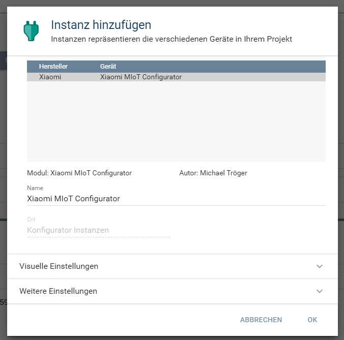
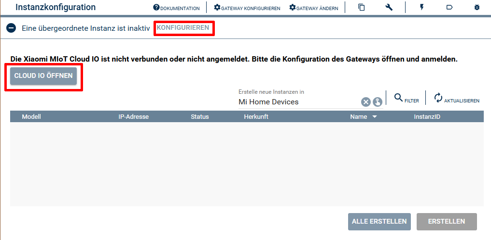

  

   

  

# Xiaomi MIoT <!-- omit in toc -->  

Ermöglicht die Einbindung von Xiaomi Geräten in Symcon.  

## Inhaltsverzeichnis <!-- omit in toc -->

- [1. Funktionsumfang](#1-funktionsumfang)
- [Vorbemerkungen](#vorbemerkungen)
  - [Zur Library](#zur-library)
  - [Zur Integration von Geräten](#zur-integration-von-geräten)
- [2. Voraussetzungen](#2-voraussetzungen)
- [3. Software-Installation](#3-software-installation)
- [4. Enthaltende Module](#4-enthaltende-module)
- [5. Anhang](#5-anhang)
  - [1. GUID der Module](#1-guid-der-module)
  - [2. Changelog](#2-changelog)
  - [3. Spenden](#3-spenden)
- [6. Lizenz](#6-lizenz)

----------

## 1. Funktionsumfang

- Einbindung von Geräten aus der Mi Home App (MIoT-Geräte von Xiaomi und Drittherstellern) in Symcon.  
- Kommunikation lokal im LAN/WLAN oder über die Xiaomi Cloud.  
- Statusvariablen mit passenden Darstellungen entstehen automatisch aus der Gerätebeschreibung des Herstellers.  
- Einrichtung über einen Konfigurator, auch für Geräte ohne lokale IP-Adresse und für Geräte, die andere Konten freigegeben haben.  

## Vorbemerkungen

### Zur Library  

Diese Library enthält keine gerätespezifischen Anpassungen für einzelne Gerätemodelle.  
Stattdessen werden alle Fähigkeiten und Eigenschaften eines Gerätes aus seiner Gerätebeschreibung (MIoT-Spezifikation) über die Xiaomi Cloud geladen.  
Entsprechend können grundsätzlich alle Geräte, auch von Drittherstellern, eingebunden werden, sofern das Gerät in der `Mi Home App` vorhanden und angelernt ist und eine MIoT-Spezifikation besitzt.  

Die Kommunikation der Geräte kann sowohl lokal (LAN/WLAN) als auch über die Cloud erfolgen.  

> [!IMPORTANT]
> **Nicht jedes Gerät unterstützt die lokale Kommunikation.** Solche Geräte werden automatisch über die Cloud angesprochen und nur zyklisch abgefragt.

Quellen der Gerätedaten: die Gerätebeschreibungen der Mi Home App bzw. von miot-spec.org, der Produktkatalog und die öffentliche App-Konfiguration der Mi Home App (Begriffe und Einheiten). Eine Übersicht der Geräte bietet [home.miot-spec.com](https://home.miot-spec.com/).  

----------

### Zur Integration von Geräten  

Es werden Instanzen zur Kommunikation mit der Cloud (Cloud IO), zum Einrichten von Geräten in Symcon (Konfigurator) und die eigentlichen Geräte-Instanzen bereitgestellt.  

> [!IMPORTANT]
> Die Cloud IO ist für jedes Gerät Pflicht: Sie benötigt dauerhaft einen Internetzugang und die Zugangsdaten des Mi Accounts (Konto der Mi Home App). Gerätedaten, Token und Gerätebeschreibung kommen aus der Cloud, auch wenn das Gerät selbst lokal kommuniziert.

> [!IMPORTANT]  
> **Für die lokale Kommunikation müssen sich die Geräte im gleichen Subnetz wie Symcon befinden, da viele Geräte eine Verbindung sonst ablehnen.**  

## 2. Voraussetzungen

- Symcon 9.0 oder höher
- Eingebundene Geräte in der Mi Home App
- Mi Account und Internetzugang

## 3. Software-Installation

Über den `Module-Store` in Symcon die Library `Xiaomi MIoT` hinzufügen.  

  

> [!TIP]
> Die Einrichtung am besten mit dem [Xiaomi MIoT Konfigurator](Xiaomi%20MIoT%20Configurator/README.md) beginnen. Nach der Installation aus dem Store wird diese Instanz auf Rückfrage automatisch angelegt.

  
  

Anschließend muss über die Schaltfläche `Konfigurieren` oder `Cloud IO öffnen` die Anmeldung in der [Xiaomi MIoT Cloud IO](Xiaomi%20MIoT%20Cloud%20IO/README.md) durchlaufen werden.  

  

Ist die [Xiaomi MIoT Cloud IO](Xiaomi%20MIoT%20Cloud%20IO/README.md) angemeldet, so werden die Geräte im [Xiaomi MIoT Konfigurator](Xiaomi%20MIoT%20Configurator/README.md) angezeigt und können dort angelegt werden.  

  

## 4. Enthaltende Module

Folgende Module beinhaltet das Xiaomi MIoT Repository:

- **Xiaomi MIoT Cloud IO** ([Dokumentation](Xiaomi%20MIoT%20Cloud%20IO/README.md))  
IO-Instanz zur Anmeldung und Kommunikation mit der Xiaomi Cloud. Liefert Geräteliste, Gerätedaten und Gerätebeschreibungen.  

- **Xiaomi MIoT Konfigurator** ([Dokumentation](Xiaomi%20MIoT%20Configurator/README.md))  
Konfigurator, der alle Geräte des Mi Accounts anzeigt und zum Anlegen von Geräte-Instanzen verwendet wird.  

- **Xiaomi MIoT Gerät** ([Dokumentation](Xiaomi%20MIoT%20Device/README.md))  
Geräte-Instanz, die jeweils ein Gerät in Symcon abbildet.  

## 5. Anhang

### 1. GUID der Module

| Modul                    | Typ          | Prefix | GUID                                   |
| ------------------------ | ------------ | ------ | -------------------------------------- |
| Xiaomi MIoT Cloud IO     | IO           | XIAOMI | {DF2248D9-FC17-4609-840D-BA52DBF9CEB6} |
| Xiaomi MIoT Configurator | Configurator | XIAOMI | {CCB7419D-F038-E519-8D63-171260FED0A0} |
| Xiaomi MIoT Device       | Device       | XIAOMI | {733AB5D2-957D-E76A-BA5D-5006701A6216} |

### 2. Changelog

**Version 2.00:**  

> [!IMPORTANT]
> - Jede Geräte-Instanz benötigt jetzt eine angemeldete [Cloud IO](Xiaomi%20MIoT%20Cloud%20IO/README.md), auch bei lokaler Kommunikation.  
> - Statusvariablen nutzen [Darstellungen](https://www.symcon.de/de/service/dokumentation/grundlagen/variablen/variablendarstellung/) statt der Variablenprofile `XIAOMI.*`. Die Umstellung erfolgt beim Update automatisch, nicht mehr genutzte Profile werden entfernt. Skripte oder Visualisierungen, die diese Profile direkt verwenden, müssen angepasst werden; die [Experteneinstellungen der Cloud IO](Xiaomi%20MIoT%20Cloud%20IO/README.md#experteneinstellungen) zeigen, wo sie noch genutzt werden.  
> - `XIAOMI_ExecuteAction` ist abgekündigt und entfällt frühestens mit Version 2.10. Jeder Aufruf erzeugt eine Warnung im Log. Ersatz ist [`XIAOMI_CallAction`](Xiaomi%20MIoT%20Device/README.md#ausführen-einer-aktion), die Rückgabewerte mit Namen liefert (z.B. `stream-address`).  
> - Bestehende Variablen behalten ihren Namen. Neue Variablen erhalten Namen aus der neuen Quelle der Gerätebeschreibung und können von früheren Versionen abweichen.  

**Neue Funktionen und Aktionen**  

- Geräte: `XIAOMI_CallAction` liefert die Rückgabewerte einer Aktion als Name-Wert-Paare mit den Namen aus der Gerätebeschreibung.  
- Cloud IO: Experteneinstellungen zum Löschen nicht mehr verwendeter Xiaomi-Profile und zur Anzeige der Variablen, die noch Xiaomi-Profile nutzen (mit Schaltfläche zum Öffnen der Variable).  

**Geändertes Verhalten**  

- Geräte: Gerätedaten, Token und Gerätebeschreibung kommen über die Cloud IO aus einer neuen Quelle (wie in der Mi Home App) und werden dort zwischengespeichert. Mehrere Geräte gleichen Typs laden die Beschreibung nur einmal.  
- Geräte: Namen, Wertelisten und Einheiten werden aus der Gerätebeschreibung und den Begriffen der Mi Home App übersetzt. Nicht übersetzte Namen werden lesbar dargestellt (z.B. `Do Not Disturb` statt `do-not-disturb`).  
- Geräte: Nach dem Schreiben eines Wertes oder dem Ausführen einer Aktion wird der Status ca. eine Sekunde später neu gelesen, damit Folgeänderungen des Gerätes sichtbar werden.  
- Geräte: `Host` ist optional. Ohne IP-Adresse wird das Gerät nur über die Cloud angesprochen.  
- Geräte: Das Konfigurationsformular zeigt Produktname und Bild aus dem Katalog der Mi Home App, die URN der Gerätebeschreibung und einen Link auf die Geräteübersicht von home.miot-spec.com.  
- Geräte: `Geräteinformationen neu laden` behält die bisherigen Daten, bis die neuen erfolgreich geladen sind. Bisher war das Gerät bei einem Ausfall der Internet-Quellen unbrauchbar.  
- Geräte: Bei Konfigurationsfehlern wird nicht mehr zyklisch neu verbunden.  
- Konfigurator: Zeigt auch Geräte, die andere Konten freigegeben haben (Spalte `Herkunft`), und Geräte ohne lokale IP-Adresse (`Nur Cloud`, Anlage erfolgt dann mit `Cloud-Verbindung erzwingen`).  
- Konfigurator: Neue Spalte `Status` (online/offline mit Symbol) ersetzt den Schalter `Zeige offline Geräte`; die Spalte MAC entfällt. Offline-Geräte werden inaktiv angelegt.  
- Konfigurator: Instanzen, die an einer anderen Cloud IO hängen, werden ausgeblendet, auch wenn eine Freigabe aus einem anderen Konto erfolgt ist.  
- Konfigurator: Für Yeelight-Leuchten und Roborock-Sauger weist er auf die passende Library im Module Store hin und kann sie installieren. Ist sie installiert, werden diese Geräte ausgeblendet (vorhandene Instanzen bleiben sichtbar).  
- Konfigurator: Wechsel oder Statusänderung der Cloud IO lädt die Liste neu. Beim Wechsel der Cloud IO werden vorhandene Cloud IOs zur Auswahl angeboten.  
- Konfigurator: Die Zusammenfassung zeigt das angemeldete Konto der verbundenen Cloud IO statt ihres Namens.  

**Fehlerbehebungen**  

- Geräte: Verspätete Antworten auf frühere Anfragen konnten als Antwort auf eine neue Anfrage gewertet werden.  
- Geräte: Speichern und Statuswechsel der Cloud IO konnten gleichzeitig einen Verbindungsaufbau starten.  
- Geräte: Gleiche Eigenschaften in verschiedenen Services (z.B. Restlaufzeit von Haupt- und Seitenbürste) teilten sich ein Profil mit falschem Wertebereich.  
- Konfigurator: Die Spalte `Modell` war nicht übersetzt.  
- Die Modulnamen waren in der Konsole nicht übersetzt (jetzt `Xiaomi MIoT Konfigurator` und `Xiaomi MIoT Gerät`).  

**Version 1.30:**  

> [!IMPORTANT]
> - Voraussetzung ist jetzt Symcon 9.0 oder höher.  
> - `XIAOMI_ExecuteAction` liefert jetzt die Rückgabewerte der Aktion als Array, `true` wenn das Gerät keine Rückgabewerte liefert und `false` im Fehlerfall.  

**Geändertes Verhalten**  

- Geräte merken sich, ob sie zuletzt lokal oder über die Cloud erreichbar waren. Geräte, die nur über die Cloud antworten, sind nach dem Speichern oder einem Neustart sofort verfügbar statt erst nach ca. 14 Sekunden.  
- Geräte, die über die Cloud kommunizieren, warten beim Systemstart auf eine aktive Cloud IO.  
- Hat sich der Token eines Gerätes geändert (z.B. nach erneutem Anlernen), wird er automatisch neu aus der Cloud geladen.  
- Der Konfigurator zeigt den Namen der verbundenen Cloud IO in der Zusammenfassung und weist auf eine fehlende oder nicht angemeldete Cloud IO hin.  
- Zugangsdaten, Token und die Sitzungsschlüssel in Stream-URLs (z.B. Kamera-Aktionen) werden in den Debug-Ausgaben nicht mehr im Klartext angezeigt. Das Konfigurationsformular der Geräte zeigt vom Token nur noch den Anfang und die Länge.  
- Verbindungsabbrüche von Geräten: Jeder fehlgeschlagene Versuch erscheint als Fehler im Log mit dem Abstand bis zum nächsten Versuch („Verbindung fehlgeschlagen, nächster Versuch in 15 Sekunden“). Der Abstand beginnt bei 15 Sekunden und verdoppelt sich wie bei der Standard-Strategie von Event Control bis höchstens 32 Minuten. „Wiederverbinden erfolgreich“ wird erst nach der ersten erfolgreichen Abfrage gemeldet.  
- Lokale Geräte: Ein nicht antwortendes Gerät wird nach höchstens ca. 5 Sekunden erkannt (bisher bis zu 21 Sekunden). Weitere Befehle warten nicht mehr auf die Zeitüberschreitung, sondern brechen sofort ab.  
- Lokale Geräte: Statusabfragen werden in Blöcken von je 10 Eigenschaften gesendet, da manche Geräte größere Anfragen verwerfen. Meldet ein Gerät „beschäftigt“, wird der Befehl einmal wiederholt.  
- Fehlercodes der Cloud werden mit Text angezeigt statt als „Unbekannter Fehler“ (z.B. „Kamera im Ruhezustand“, „Fehler im entfernten Dienst, das Gerät konnte den Befehl nicht verarbeiten“).  

**Fehlerbehebungen**  

- Geräte: Aktionen, die Rückgabewerte liefern, führten zu einem Fehler.  
- Geräte: Vom Gerät abgelehnte Werte wurden trotzdem in die Statusvariable übernommen und als Erfolg gemeldet.  
- Geräte: Unbekannte Fehlercodes von Gerät oder Cloud führten zu einem Fehler statt zu einer Meldung.  
- Geräte: Im Fehlerzustand wurde weiter zyklisch abgefragt und das Log mit „Instanz ist nicht aktiv“ gefüllt.  
- Geräte: Befehle direkt nach dem Speichern schlugen mit „Senden blockiert“ fehl.  
- Geräte: Aktionsvariablen vom Typ Text zeigten den Wert „-1“.  
- Geräte: Inaktive Instanzen meldeten bei jedem Übernehmen „getrennt“ im Log.  
- Geräte: „Verbindung hergestellt“ erschien beim Speichern oder Neustart doppelt im Log.  
- Geräte: Update von sehr alten Versionen konnte fehlschlagen.  
- Cloud IO: Der Abschluss der Zwei-Faktor-Anmeldung konnte fehlschlagen.  
- Cloud IO: Bei erforderlicher Zwei-Faktor-Anmeldung wurde zusätzlich „Nicht autorisiert“ gemeldet.  
- Cloud IO: Eine nicht angemeldete Cloud IO ging nach einem Neustart in den Fehlerzustand.  
- Cloud IO: Sprach- und Zeitzonen-Angabe an die Cloud wurde fehlerhaft übertragen.  
- Fehlende Übersetzungen von Fehlermeldungen und Ländern ergänzt.  

**Version 1.23:**  

- Einige Anpassungen wieder entfernt, nachdem die Quelle der Geräteeigenschaften wieder verfügbar ist.  

**Version 1.22:**  

- Das anlegen von Geräte Instanzen über den Konfigurator ist wieder möglich  
- Laden von Geräteinformationen über die Cloud wurde auf die geänderte MioT Cloud API angepasst  
- Beim Update werden fehlende Attribute der Geräte Instanzen erkannt und neu aus der Cloud geladen  
- Instanzen konnten den falschen Zustand annehmen, wenn die Cloud nicht erreichbar war  
  
**Version 1.21:**  

- Konfigurator unterstützt aktuell keine Roborock Geräte mehr, da hier Fehler auftraten
- Abgelaufener ServiceToken wird automatisch erneuert
  
**Version 1.20:**  

- 2FA/MFA Unterstützung für Cloud Login hinzugefügt  
- Fehlerbehebungen und Verbesserungen  

**Version 1.11:**  

- Token konnte nicht ermittelt werden  
  
**Version 1.10:**  

- In den Geräte Instanzen können nicht genutzte Statusvariablen deaktiviert werden  
- Diverse Übersetzungen ergänzt  
  
**Version 1.05:**  

- Übersetzungen von Tagen, Stunden, Minuten, Sekunden fehlte  
- Fehlende Übersetzungen der Systemsprache werden aus der englischen Übersetzung des Gerätes ergänzt  
- Cloud IO zeigt den Benutzernamen in der Info Spalte an, damit mehrere Instanzen besser unterschieden werden können  
- Konfigurator  berücksichtigt nur Instanzen welche am selben IO hängen (oder bei Roborock-Instanzen welche den gleichen Cloud Usernamen haben)  
- Geräte Instanz zeigt das Modul in der Info Spalte an  

**Version 1.01:**  

- Start der offenen Beta  

### 3. Spenden  
  
Die Library ist für die nicht kommerzielle Nutzung kostenlos, Schenkungen als Unterstützung für den Autor werden hier akzeptiert:  

  

  

## 6. Lizenz

  Symcon-Modul:  
  [Custom NC-SA](LICENSE)
