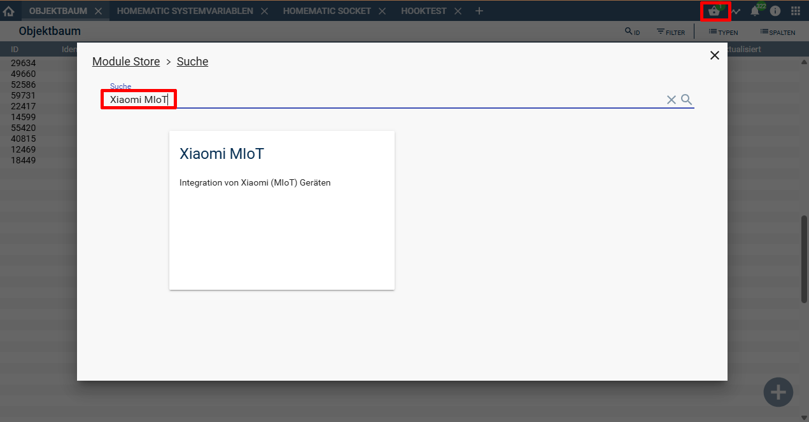
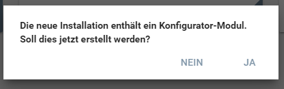
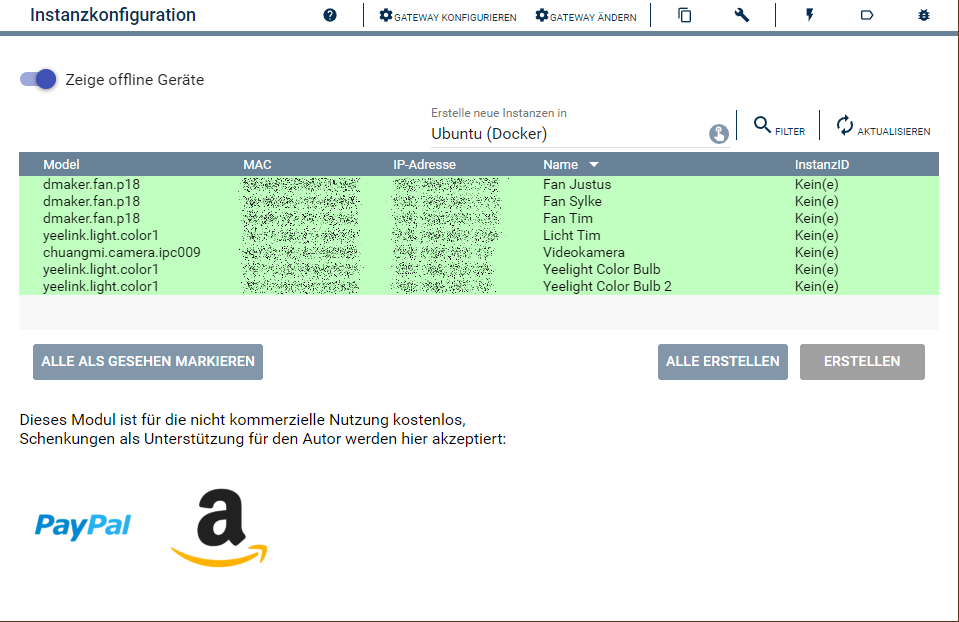

  

   

  

# Xiaomi MIoT <!-- omit in toc -->  

Ermöglicht die Einbindung von Xiaomi Geräten in Symcon.  

## Inhaltsverzeichnis <!-- omit in toc -->

- [1. Vorbemerkungen](#1-vorbemerkungen)
  - [Zur Library](#zur-library)
  - [Zur Integration von Geräten](#zur-integration-von-geräten)
- [2. Voraussetzungen](#2-voraussetzungen)
- [3. Enthaltende Module](#3-enthaltende-module)
- [4. Software-Installation](#4-software-installation)
- [5. Einrichten der Instanzen in Symcon](#5-einrichten-der-instanzen-in-symcon)
- [6. Anhang](#6-anhang)
  - [1. GUID der Module](#1-guid-der-module)
  - [2. Changelog](#2-changelog)
  - [3. Spenden](#3-spenden)
- [7. Lizenz](#7-lizenz)

----------

## 1. Vorbemerkungen

### Zur Library  

Diese Library enthält keine Gerätespezifischen Anpassungen für einzelne Gerätemodelle.  
Stattdessen werden alle Fähigkeiten und Eigenschaften von Geräten einmalig aus der Xiaomi Cloud geladen.  
Entsprechend können grundsätzlich alle Geräte, auch von Drittherstellern, eingebunden werden, sofern das Gerät in der `Mi Home App` vorhanden und angelernt ist.  

Die Kommunikation der Geräte kann sowohl lokal (LAN/WLAN) als auch über die Cloud erfolgen.  

> [!IMPORTANT]
> **Jedoch unterstützt nicht jedes Gerät die lokale Kommunikation.**  

----------

### Zur Integration von Geräten  

Es werden Instanzen zur Kommunikation mit der Cloud (Cloud IO), einrichten von Geräten in Symcon (Konfigurator) und die eigentlichen Geräte Instanzen bereitgestellt.  

Für die Ersteinrichtung ist zwingend ein Internetzugang, sowie die Zugangsdaten des Account der Mi Cloud (Mi Account bzw. Konto der Mi Home App) nötig.  

> [!IMPORTANT]  
> **Die Geräte müssen sich im gleichen Subnet wie Symcon befindet, da viele Geräte eine Verbindung sonst ablehnen und somit keine Kommunikation möglich ist.**  

## 2. Voraussetzungen

- Symcon 9.0 oder höher
- Eingebundene Geräte in der Mi Home App

## 3. Enthaltende Module

Folgende Module beinhaltet das Xiaomi MIoT Repository:

- **Xiaomi MIoT Cloud IO** ([Dokumentation](Xiaomi%20MIoT%20Cloud%20IO/README.md))  
IO Instanz zur Kommunikation mit der Cloud.  

- **Xiaomi MIoT Configurator** ([Dokumentation](Xiaomi%20MIoT%20Configurator/README.md))  
Konfigurator welche alle in der Cloud vorhandenen Geräte anzeigt und zum erstellen von Geräte Instanzen verwendet wird.

- **Xiaomi MIoT Device** ([Dokumentation](Xiaomi%20MIoT%20Device/README.md))  
Geräte Instanz, welche die jeweils ein Gerät in Symcon abbildet.

## 4. Software-Installation

Über den `Module-Store` in Symcon die Library `Xiaomi MIoT` hinzufügen.  
**Bei kommerzieller Nutzung (z.B. als Errichter oder Integrator) wenden Sie sich bitte an den Autor.**  

  

## 5. Einrichten der Instanzen in Symcon

Details sind direkt in der Dokumentation der jeweiligen Module beschrieben.  
Es wird empfohlen die Einrichtung mit der Konfigurator-Instanz zu starten [Xiaomi MIoT Configurator](Xiaomi%20MIoT%20Configurator/README.md).  
Nach der installation aus dem Store wird diese Instanz auf Rückfrage automatisch angelegt.
  
  
Anschließend muss über den Button `Konfigurieren` die Anmeldung in der [Xiaomi MIoT Cloud](Xiaomi%20MIoT%20Cloud%20IO/README.md) durchlaufen werden.  
  
Ist die [Xiaomi MIoT Cloud](Xiaomi%20MIoT%20Cloud%20IO/README.md) Instanz verbunden, so werden die Geräte im [Xiaomi MIoT Configurator](Xiaomi%20MIoT%20Configurator/README.md) angezeigt.
  

## 6. Anhang

### 1. GUID der Module

| Modul                    | Typ          | Prefix | GUID                                   |
| ------------------------ | ------------ | ------ | -------------------------------------- |
| Xiaomi MIoT Cloud IO     | IO           | XIAOMI | {DF2248D9-FC17-4609-840D-BA52DBF9CEB6} |
| Xiaomi MIoT Configurator | Configurator | XIAOMI | {CCB7419D-F038-E519-8D63-171260FED0A0} |
| Xiaomi MIoT Device       | Device       | XIAOMI | {733AB5D2-957D-E76A-BA5D-5006701A6216} |

### 2. Changelog

**Version 1.30:**  

> [!IMPORTANT]
> - Voraussetzung ist jetzt Symcon 9.0 oder höher.  
> - `XIAOMI_ExecuteAction` liefert jetzt die Rückgabewerte der Aktion als Array, `true` wenn das Gerät keine Rückgabewerte liefert und `false` im Fehlerfall.  

**Geändertes Verhalten**  

- Geräte merken sich, ob sie zuletzt lokal oder über die Cloud erreichbar waren. Geräte, die nur über die Cloud antworten, sind nach dem Speichern oder einem Neustart sofort verfügbar statt erst nach ca. 14 Sekunden.  
- Geräte, die über die Cloud kommunizieren, warten beim Systemstart auf eine aktive Cloud IO.  
- Hat sich der Token eines Gerätes geändert (z.B. nach erneutem Anlernen), wird er automatisch neu aus der Cloud geladen.  
- Der Konfigurator zeigt den Namen der verbundenen Cloud IO in der Zusammenfassung und weist auf eine fehlende oder nicht angemeldete Cloud IO hin.  
- Zugangsdaten, Token und die Sitzungsschlüssel in Stream-URLs (z.B. Kamera-Aktionen) werden in den Debug-Ausgaben nicht mehr im Klartext angezeigt. Das Konfigurationsformular der Geräte zeigt vom Token nur noch den Anfang und die Länge.  
- Verbindungsabbrüche von Geräten: Jeder fehlgeschlagene Versuch erscheint als Fehler im Log mit dem Abstand bis zum nächsten Versuch („Verbindung fehlgeschlagen, nächster Versuch in 15 Sekunden“). Der Abstand beginnt bei 15 Sekunden und verdoppelt sich wie bei der Standard-Strategie von Event Control bis höchstens 32 Minuten. „Wiederverbinden erfolgreich“ wird erst nach der ersten erfolgreichen Abfrage gemeldet.  
- Lokale Geräte: Ein nicht antwortendes Gerät wird nach höchstens ca. 5 Sekunden erkannt (bisher bis zu 21 Sekunden). Weitere Befehle warten nicht mehr auf die Zeitüberschreitung, sondern brechen sofort ab.  
- Lokale Geräte: Statusabfragen werden in Blöcken von je 10 Eigenschaften gesendet, da manche Geräte größere Anfragen verwerfen. Meldet ein Gerät „beschäftigt“, wird der Befehl einmal wiederholt.  
- Fehlercodes der Cloud werden mit Text angezeigt statt als „Unbekannter Fehler“ (z.B. „Kamera im Ruhezustand“, „Fehler im entfernten Dienst, das Gerät konnte den Befehl nicht verarbeiten“).  

**Fehlerbehebungen**  

- Geräte: Aktionen, die Rückgabewerte liefern, führten zu einem Fehler.  
- Geräte: Vom Gerät abgelehnte Werte wurden trotzdem in die Statusvariable übernommen und als Erfolg gemeldet.  
- Geräte: Unbekannte Fehlercodes von Gerät oder Cloud führten zu einem Fehler statt zu einer Meldung.  
- Geräte: Im Fehlerzustand wurde weiter zyklisch abgefragt und das Log mit „Instanz ist nicht aktiv“ gefüllt.  
- Geräte: Befehle direkt nach dem Speichern schlugen mit „Senden blockiert“ fehl.  
- Geräte: Aktionsvariablen vom Typ Text zeigten den Wert „-1“.  
- Geräte: Inaktive Instanzen meldeten bei jedem Übernehmen „getrennt“ im Log.  
- Geräte: „Verbindung hergestellt“ erschien beim Speichern oder Neustart doppelt im Log.  
- Geräte: Update von sehr alten Versionen konnte fehlschlagen.  
- Cloud IO: Der Abschluss der Zwei-Faktor-Anmeldung konnte fehlschlagen.  
- Cloud IO: Bei erforderlicher Zwei-Faktor-Anmeldung wurde zusätzlich „Nicht autorisiert“ gemeldet.  
- Cloud IO: Eine nicht angemeldete Cloud IO ging nach einem Neustart in den Fehlerzustand.  
- Cloud IO: Sprach- und Zeitzonen-Angabe an die Cloud wurde fehlerhaft übertragen.  
- Fehlende Übersetzungen von Fehlermeldungen und Ländern ergänzt.  

**Version 1.23:**  

- Einige Anpassungen wieder entfernt, nachdem die Quelle der Geräteeigenschaften wieder verfügbar ist.  

**Version 1.22:**  

- Das anlegen von Geräte Instanzen über den Konfigurator ist wieder möglich  
- Laden von Geräteinformationen über die Cloud wurde auf die geänderte MioT Cloud API angepasst  
- Beim Update werden fehlende Attribute der Geräte Instanzen erkannt und neu aus der Cloud geladen  
- Instanzen konnten den falschen Zustand annehmen, wenn die Cloud nicht erreichbar war  
  
**Version 1.21:**  

- Konfigurator unterstützt aktuell keine Roborock Geräte mehr, da hier Fehler auftraten
- Abgelaufener ServiceToken wird automatisch erneuert
  
**Version 1.20:**  

- 2FA/MFA Unterstützung für Cloud Login hinzugefügt  
- Fehlerbehebungen und Verbesserungen  

**Version 1.11:**  

- Token konnte nicht ermittelt werden  
  
**Version 1.10:**  

- In den Geräte Instanzen können nicht genutzte Statusvariablen deaktiviert werden  
- Diverse Übersetzungen ergänzt  
  
**Version 1.05:**  

- Übersetzungen von Tagen, Stunden, Minuten, Sekunden fehlte  
- Fehlende Übersetzungen der Systemsprache werden aus der englischen Übersetzung des Gerätes ergänzt  
- Cloud IO zeigt den Benutzernamen in der Info Spalte an, damit mehrere Instanzen besser unterschieden werden können  
- Konfigurator  berücksichtigt nur Instanzen welche am selben IO hängen (oder bei Roborock-Instanzen welche den gleichen Cloud Usernamen haben)  
- Geräte Instanz zeigt das Modul in der Info Spalte an  

**Version 1.01:**  

- Start der offenen Beta  

### 3. Spenden  
  
Die Library ist für die nicht kommerzielle Nutzung kostenlos, Schenkungen als Unterstützung für den Autor werden hier akzeptiert:  

  

  

## 7. Lizenz

  Symcon-Modul:  
  [CC BY-NC-SA 4.0](https://creativecommons.org/licenses/by-nc-sa/4.0/)  
