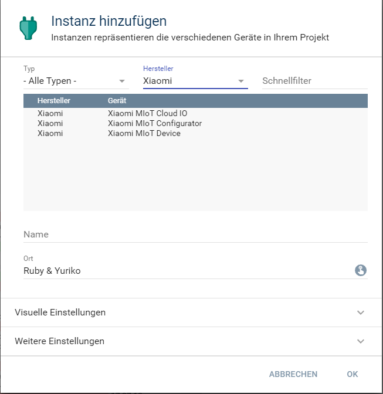
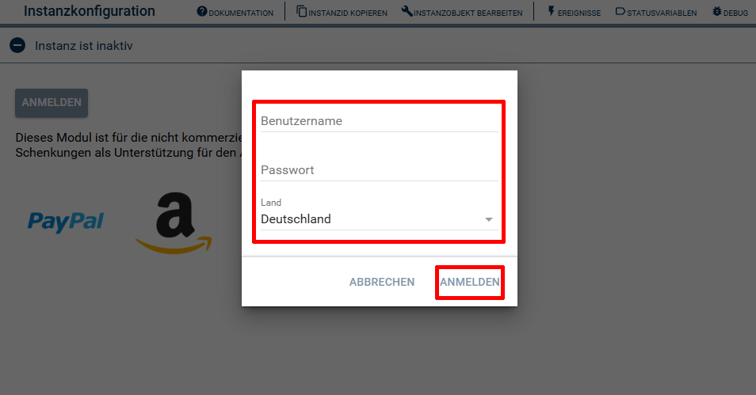
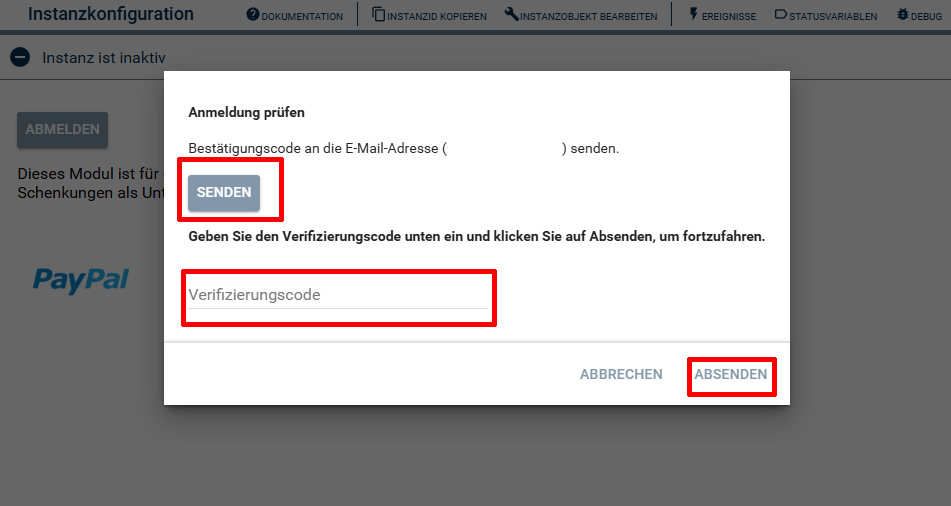

[](https://www.symcon.de/service/dokumentation/entwicklerbereich/sdk-tools/sdk-php/)
[](https://community.symcon.de/t/modul-xiaomi-miot/135200/)
[](https://www.symcon.de/de/service/dokumentation/installation/migrationen/v63-v64-q2-2023/)  
[](https://creativecommons.org/licenses/by-nc-sa/4.0/)
[](https://github.com/Nall-chan/Xiaomi/actions) [](https://github.com/Nall-chan/Xiaomi/actions)  
[](#2-spenden)
[](#2-spenden)  

# Xiaomi MIoT Cloud IO <!-- omit in toc -->  

## Inhaltsverzeichnis <!-- omit in toc -->  

- [1. Funktionsumfang](#1-funktionsumfang)
- [2. Voraussetzungen](#2-voraussetzungen)
- [3. Software-Installation](#3-software-installation)
- [4. Einrichten der Instanzen in Symcon](#4-einrichten-der-instanzen-in-symcon)
- [5. Statusvariablen](#5-statusvariablen)
- [6. Visualisierung](#6-visualisierung)
- [7. PHP-Befehlsreferenz](#7-php-befehlsreferenz)
- [8. Aktionen](#8-aktionen)
- [9. Anhang](#9-anhang)
  - [1. Changelog](#1-changelog)
  - [2. Spenden](#2-spenden)
- [10. Lizenz](#10-lizenz)

## 1. Funktionsumfang

- Instanz für die Kommunikation mit der MIoT Cloud.  

## 2. Voraussetzungen

- Symcon 9.0 oder höher
- Eingebundene Geräte in der Mi Home App

## 3. Software-Installation

- Dieses Modul ist Bestandteil der [Xiaomi MIoT-Library](../README.md#4-software-installation).  

## 4. Einrichten der Instanzen in Symcon

 Unter `Instanz hinzufügen` ist das `Xiaomi MIoT Cloud IO`-Modul unter dem Hersteller `Xiaomi` aufgeführt.  
  

Diese Instanz wird automatisch mit erzeugt, wenn eine neue Instanz vom [MIoT Configurator-Modul](../Xiaomi%20MIoT%20Configurator/README.md) angelegt wird.  

Besitzt die Instanz keine Verbindung zur Cloud, so wird beim öffnen der Konfiguration automatisch die Anmeldeseite angezeigt.
  

Eventuell muss eine 2FA (Zwei-Faktor-Authentifizierung) einmalig durchlaufen werden, um die Anmeldung abzuschließen.  
> [!WARNING]
> Wird die Instanz gelöscht, so muss die Zwei-Faktor-Authentifizierung erneut durchlaufen werden!  

  

Hierzu ist zuerst die Schaltfläche 'Senden' zu betätigen, um den Code an die hinterlegte E-Mail-Adresse oder Telefonnummer zu senden.  
Anschließend ist der erhaltene Code in das Feld `Verifizierungscode` einzutragen und mit 'Absenden' abzuschicken.

> [!IMPORTANT]
> Da es diverse Geräte gibt, welche keine direkte Kommunikation im lokalen Netzwerk erlauben, versucht die `Xiaomi MIoT Geräte`-Instanz das Gerät dann über die Cloud anzusprechen.  
> Dazu muss zwingend eine `Xiaomi MIoT Cloud IO`-Instanz als Gateway verbunden sein.  

## 5. Statusvariablen

Dieses Modul erstellt keine Statusvariablen.  

## 6. Visualisierung

Dieses Modul ist nicht für die Visualisierung geeignet.

## 7. PHP-Befehlsreferenz

> [!TIP]
> Die Anmeldung erfolgt am einfachsten über die Konfiguration der Instanz (siehe [Einrichten der Instanzen](#4-einrichten-der-instanzen-in-symcon)). Die folgenden Funktionen werden von diesem Formular verwendet und können auch in Skripten genutzt werden.

### Anmelden  

```php
string XIAOMI_SetCredentials(integer $InstanzID, string $Username, string $Password, string $Country);
```

Meldet die Instanz mit den Zugangsdaten des Mi Accounts (Konto der Mi Home App) an.  
`$Username` ist die E-Mail-Adresse, Telefonnummer oder Konto-ID des Mi Accounts, `$Password` das zugehörige Passwort.  
`$Country` ist der Server bzw. die Region, in welcher die Geräte in der Mi Home App angelernt sind:  

| Wert | Region                   |
| ---- | ------------------------ |
| `cn` | China                    |
| `de` | Deutschland (Europa)     |
| `ru` | Russland                 |
| `us` | Amerika                  |
| `tw` | Taiwan                   |
| `sg` | Singapur                 |
| `in` | Indien                   |
| `i2` | Indien (zweiter Server)  |

Rückgabe: Ein leerer String, wenn die Anmeldung erfolgreich war oder eine Zwei-Faktor-Verifizierung gestartet wurde. Andernfalls die Fehlermeldung (z.B. `Nicht autorisiert`).  
Ist eine Zwei-Faktor-Verifizierung erforderlich, bleibt die Instanz inaktiv, bis der Code mit `XIAOMI_SubmitVerificationCode` bestätigt wurde.  

Beispiel:  

```php
$Result = XIAOMI_SetCredentials(12345, 'user@example.com', 'Passwort', 'de');
if ($Result != '') {
    echo $Result;
}
```

---  

### Verifizierungscode anfordern  

```php
string XIAOMI_SendVerificationCode(integer $InstanzID);
```

Lässt den Code für die Zwei-Faktor-Verifizierung an die im Mi Account hinterlegte E-Mail-Adresse bzw. Telefonnummer senden.  
Nur nach einem `XIAOMI_SetCredentials`, welches eine Verifizierung gestartet hat, sinnvoll.  
Rückgabe: Ein leerer String bei Erfolg, andernfalls die Fehlermeldung.  

Beispiel:  

```php
XIAOMI_SendVerificationCode(12345);
```

---  

### Verifizierungscode bestätigen  

```php
string XIAOMI_SubmitVerificationCode(integer $InstanzID, string $Code);
```

Bestätigt die Anmeldung mit dem per E-Mail bzw. SMS erhaltenen Code (`$Code`).  
Rückgabe: Bei Erfolg der Text `MESSAGE:Verifizierung erfolgreich!` (das Präfix `MESSAGE:` sorgt im Formular für die Anzeige als Meldung), andernfalls die Fehlermeldung.  

Beispiel:  

```php
echo XIAOMI_SubmitVerificationCode(12345, '123456');
```

---  

### Abmelden  

```php
void XIAOMI_Logout(integer $InstanzID);
```

Löscht die gespeicherten Zugangsdaten und Token der Instanz. Die Instanz wird inaktiv, verbundene Geräte-Instanzen können anschließend nicht mehr über die Cloud kommunizieren.  

Beispiel:  

```php
XIAOMI_Logout(12345);
```
## 8. Aktionen

Es gibt keine speziellen Aktionen für dieses Modul.  

## 9. Anhang

### 1. Changelog

[Changelog der Library](../README.md#2-changelog)

### 2. Spenden

Die Library ist für die nicht kommerzielle Nutzung kostenlos, Schenkungen als Unterstützung für den Autor werden hier akzeptiert:  

[](https://paypal.me/Nall4chan)  

[](https://www.amazon.de/hz/wishlist/ls/YU4AI9AQT9F?ref_=wl_share)  

## 10. Lizenz

  Symcon-Modul:  
  [CC BY-NC-SA 4.0](https://creativecommons.org/licenses/by-nc-sa/4.0/)  
