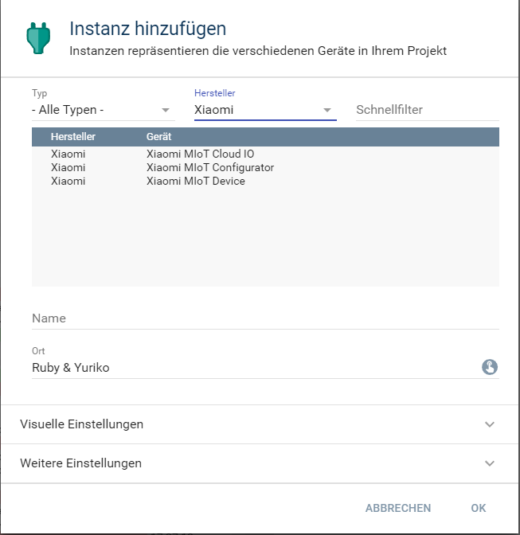
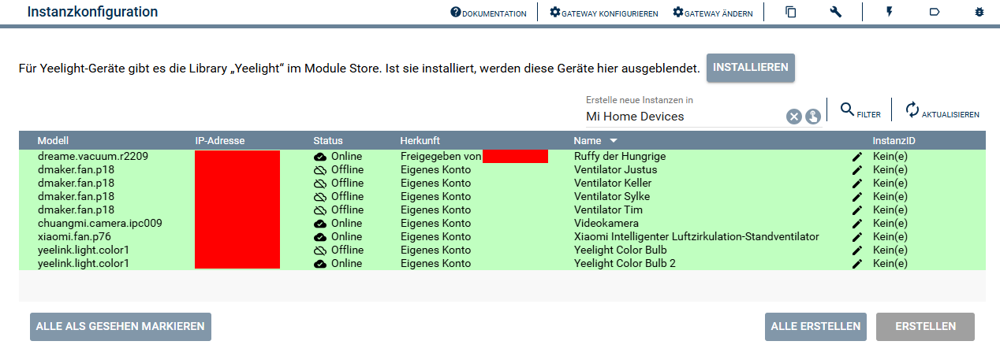

  

   

  

# Xiaomi MIoT Konfigurator <!-- omit in toc -->  

## Inhaltsverzeichnis <!-- omit in toc -->  

- [1. Funktionsumfang](#1-funktionsumfang)
- [2. Voraussetzungen](#2-voraussetzungen)
- [3. Software-Installation](#3-software-installation)
- [4. Einrichten der Instanzen in Symcon](#4-einrichten-der-instanzen-in-symcon)
  - [Konfigurationsseite](#konfigurationsseite)
  - [Geräte mit eigener Library](#geräte-mit-eigener-library)
  - [Mehrere Mi Accounts](#mehrere-mi-accounts)
- [5. Statusvariablen](#5-statusvariablen)
- [6. Visualisierung](#6-visualisierung)
- [7. PHP-Befehlsreferenz](#7-php-befehlsreferenz)
- [8. Aktionen](#8-aktionen)
- [9. Anhang](#9-anhang)
  - [1. Changelog](#1-changelog)
  - [2. Spenden](#2-spenden)
- [10. Lizenz](#10-lizenz)

## 1. Funktionsumfang

- Listet alle Geräte des Mi Accounts der verbundenen [Cloud IO](../Xiaomi%20MIoT%20Cloud%20IO/README.md), auch Geräte, die andere Konten für dieses Konto freigegeben haben.  
- Legt [Geräte-Instanzen](../Xiaomi%20MIoT%20Device/README.md) mit Geräte-ID, IP-Adresse und passenden Cloud-Einstellungen an.  
- Zeigt, ob ein Gerät online ist, und gleicht die Liste mit vorhandenen Instanzen ab.  

## 2. Voraussetzungen

- Symcon 9.0 oder höher
- Eingebundene Geräte in der Mi Home App
- Eine angemeldete [Xiaomi MIoT Cloud IO](../Xiaomi%20MIoT%20Cloud%20IO/README.md)

## 3. Software-Installation

- Dieses Modul ist Bestandteil der [Xiaomi MIoT-Library](../README.md#3-software-installation).  

## 4. Einrichten der Instanzen in Symcon

Unter `Instanz hinzufügen` ist das `Xiaomi MIoT Konfigurator`-Modul unter dem Hersteller `Xiaomi` aufgeführt.  

  

Beim Anlegen wird automatisch eine neue [Cloud IO](../Xiaomi%20MIoT%20Cloud%20IO/README.md) erzeugt, alternativ kann eine vorhandene gewählt werden. Der Konfigurator hat keine eigenen Eigenschaften.  

### Konfigurationsseite

  

Ist keine angemeldete Cloud IO verbunden, zeigt der Konfigurator einen Hinweis und die Schaltfläche `Cloud IO öffnen`, um die Anmeldung nachzuholen. Wechselt die Cloud IO oder ihr Status, lädt die Liste neu.  

| Spalte     | Inhalt                                                                                         |
| ---------- | ---------------------------------------------------------------------------------------------- |
| Modell     | Modell des Gerätes, z.B. `xiaomi.fan.p76`                                                      |
| IP-Adresse | Lokale IP-Adresse laut Cloud, `Nur Cloud` bei Geräten ohne lokale Adresse                      |
| Status     | `Online` bzw. `Offline` laut Cloud                                                             |
| Herkunft   | `Eigenes Konto` oder `Freigegeben von <Konto>` bei Geräten, die ein anderes Konto freigegeben hat |
| Name       | Name der vorhandenen Instanz, sonst der Name aus der Mi Home App                                |

Beim Anlegen einer Instanz:  

- Geräte ohne lokale IP-Adresse werden ohne `Host` und mit `Cloud-Verbindung erzwingen` angelegt.  
- Offline-Geräte werden inaktiv angelegt.  
- Gateways werden nicht angezeigt.  

Instanzen, die an dieser Cloud IO hängen, deren Gerät aber (aktuell) nicht in der Cloud gefunden wird, erscheinen ohne Modell und Status in der Liste.  

### Geräte mit eigener Library

Für einige Geräte gibt es eigene Libraries im Module Store:  

| Geräte                                         | Library                              |
| ---------------------------------------------- | ------------------------------------ |
| Yeelight-Leuchten (`yeelink.light.*`)          | Yeelight                             |
| Roborock-Sauger (`roborock.vacuum.*`, `rockrobo.vacuum.*`) | Roborock                 |

Ist die Library nicht installiert und die Cloud liefert ein passendes Gerät, zeigt der Konfigurator einen Hinweis mit der Schaltfläche `Installieren`. Nach einer Rückfrage wird die Library aus dem Module Store installiert (stabiler Kanal, sonst Beta). Dafür müssen die Bedingungen des Module Store bestätigt sein, sonst ist die Schaltfläche gesperrt. Bis zur Installation bietet der Konfigurator die Geräte weiter zum Anlegen an. Ist sie installiert, werden diese Geräte ausgeblendet und sind über die jeweilige Library einzurichten. Bereits vorhandene Instanzen dieses Moduls an der eigenen Cloud IO bleiben sichtbar.  

### Mehrere Mi Accounts

Hat jedes Familienmitglied ein eigenes Konto mit eigener Cloud IO und eigenem Konfigurator, zeigt jeder Konfigurator nur die Geräte, die noch keine Instanz haben oder deren Instanz an seiner Cloud IO hängt. Ein Gerät, das bereits über ein anderes Konto eingerichtet ist (z.B. ein freigegebenes Gerät), wird ausgeblendet. Die Zusammenfassung des Konfigurators zeigt den Anmeldenamen der verbundenen Cloud IO.  

## 5. Statusvariablen

Dieses Modul erstellt keine Statusvariablen.  

## 6. Visualisierung

Dieses Modul ist nicht für die Visualisierung geeignet.

## 7. PHP-Befehlsreferenz

Dieses Modul stellt keine Instanz-Funktionen bereit.

## 8. Aktionen

Es gibt keine speziellen Aktionen für dieses Modul.  

## 9. Anhang

### 1. Changelog

[Changelog der Library](../README.md#2-changelog)

### 2. Spenden

Die Library ist für die nicht kommerzielle Nutzung kostenlos, Schenkungen als Unterstützung für den Autor werden hier akzeptiert:  

  

  

## 10. Lizenz

  Symcon-Modul:  
  [Custom NC-SA](../LICENSE)
