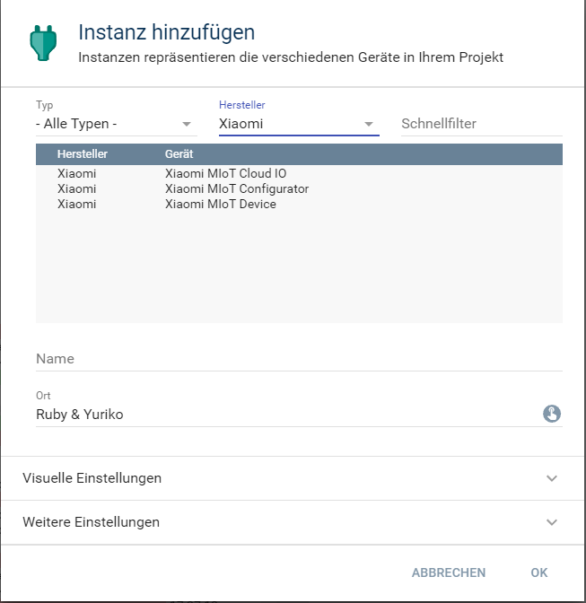
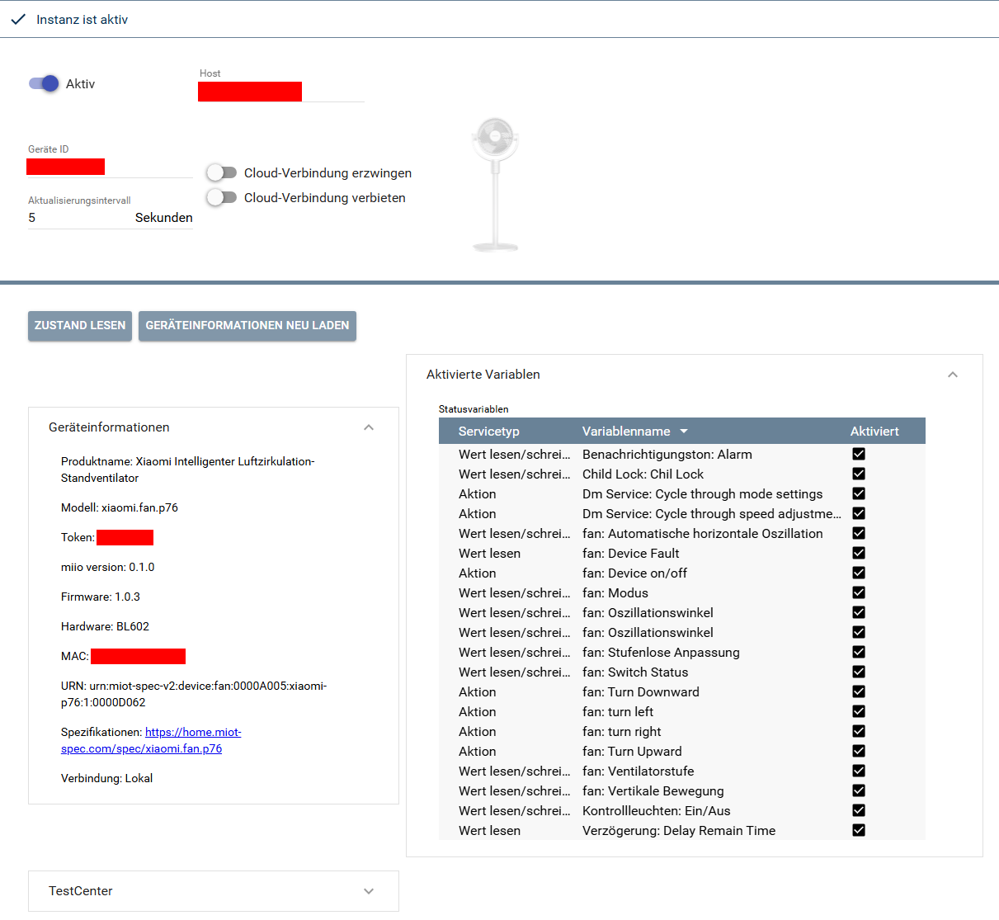
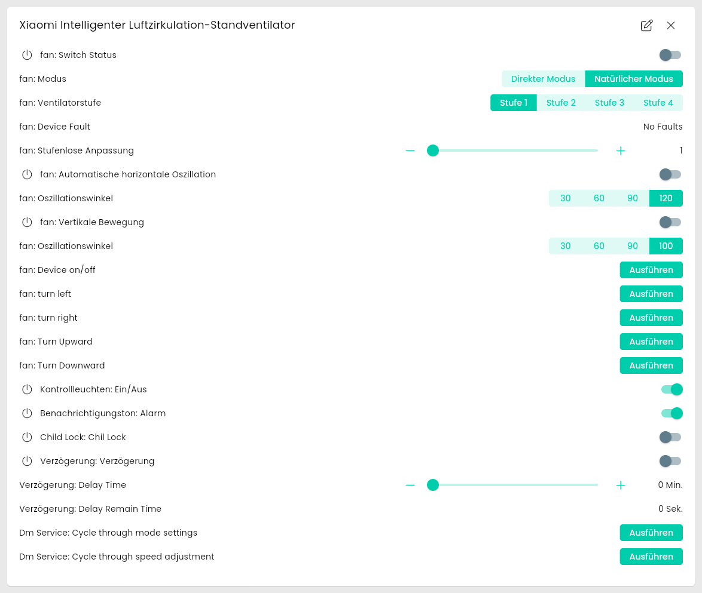

[](https://www.symcon.de/service/dokumentation/entwicklerbereich/sdk-tools/sdk-php/)
[](https://community.symcon.de/t/modul-xiaomi-miot/135200/)
[](https://www.symcon.de/de/service/dokumentation/installation/migrationen/v63-v64-q2-2023/)  
[](#10-lizenz)
[](https://github.com/Nall-chan/Xiaomi/actions) [](https://github.com/Nall-chan/Xiaomi/actions)  
[](#2-spenden)
[](#2-spenden)  

# Xiaomi MIoT Device <!-- omit in toc -->  

## Inhaltsverzeichnis <!-- omit in toc -->  

- [1. Funktionsumfang](#1-funktionsumfang)
- [2. Voraussetzungen](#2-voraussetzungen)
- [3. Software-Installation](#3-software-installation)
- [4. Einrichten der Instanzen in Symcon](#4-einrichten-der-instanzen-in-symcon)
  - [Konfigurationsseite (Parameter)](#konfigurationsseite-parameter)
  - [Lokal oder Cloud](#lokal-oder-cloud)
  - [Konfigurationsseite (Status und Bedienung)](#konfigurationsseite-status-und-bedienung)
- [5. Statusvariablen](#5-statusvariablen)
- [6. Visualisierung](#6-visualisierung)
  - [Kachel Visualisierung](#kachel-visualisierung)
  - [WebFront Visualisierung](#webfront-visualisierung)
- [7. PHP-Befehlsreferenz](#7-php-befehlsreferenz)
  - [Zustandsabfrage](#zustandsabfrage)
  - [Schreiben von Werten](#schreiben-von-werten)
  - [Ausführen einer Aktion](#ausführen-einer-aktion)
  - [Ausführen einer Aktion (abgekündigt)](#ausführen-einer-aktion-abgekündigt)
- [8. Aktionen](#8-aktionen)
- [9. Anhang](#9-anhang)
  - [1. Changelog](#1-changelog)
  - [2. Spenden](#2-spenden)
- [10. Lizenz](#10-lizenz)

## 1. Funktionsumfang

- Bildet ein Gerät aus der Mi Home App in Symcon ab.  
- Die Statusvariablen und ihre Darstellungen entstehen automatisch aus der Gerätebeschreibung (MIoT-Spezifikation), die über die [Cloud IO](../Xiaomi%20MIoT%20Cloud%20IO/README.md) geladen wird.  
- Kommunikation lokal im LAN/WLAN oder über die Xiaomi Cloud, der zuletzt funktionierende Weg wird gemerkt.  
- Zyklische Statusabfrage, nach jedem Schreiben oder Ausführen einer Aktion wird der Status ca. eine Sekunde später neu gelesen.  
- Produktname und Produktbild aus dem Katalog der Mi Home App in der Konfiguration.  

## 2. Voraussetzungen

- Symcon 9.0 oder höher
- Eingebundene Geräte in der Mi Home App
- Eine angemeldete [Xiaomi MIoT Cloud IO](../Xiaomi%20MIoT%20Cloud%20IO/README.md) als übergeordnete Instanz

## 3. Software-Installation

- Dieses Modul ist Bestandteil der [Xiaomi MIoT-Library](../README.md#3-software-installation).  

## 4. Einrichten der Instanzen in Symcon

Unter `Instanz hinzufügen` ist das `Xiaomi MIoT Device`-Modul unter dem Hersteller `Xiaomi` aufgeführt.  

  

> [!TIP]
> Die Instanz am einfachsten über den [Xiaomi MIoT Configurator](../Xiaomi%20MIoT%20Configurator/README.md) anlegen. Er trägt Geräte-ID, IP-Adresse und die passenden Cloud-Einstellungen selbst ein.

  

### Konfigurationsseite (Parameter)  

| Eigenschaft                | Name            | Typ     | Standardwert | Beschreibung                                                                                             |
| -------------------------- | --------------- | ------- | ------------ | -------------------------------------------------------------------------------------------------------- |
| Aktiv                      | Open            | boolean | false        | Verbindung zum Gerät aktiv                                                                               |
| Host                       | Host            | string  |              | IP-Adresse des Gerätes im lokalen Netz. Leer = Gerät nur über die Cloud ansprechen                       |
| Geräte ID                  | DeviceId        | string  |              | Geräte-ID (`did`) aus der Cloud, eindeutige Kennung des Gerätes im Mi Account                            |
| Aktualisierungsintervall   | RefreshInterval | integer | 60           | Abstand der Statusabfragen in Sekunden, `0` = keine zyklische Abfrage                                    |
| Cloud-Verbindung erzwingen | ForceCloud      | boolean | false        | Gerät ausschließlich über die Cloud ansprechen                                                           |
| Cloud-Verbindung verbieten | DeniedCloud     | boolean | false        | Nie auf die Cloud ausweichen, auch wenn das Gerät lokal nicht antwortet (ohne `Host` nicht einstellbar) |

Modell, Token und Gerätebeschreibung muss der Nutzer nicht eintragen: Die Instanz lädt sie anhand der Geräte-ID über die Cloud IO.  

Beispiel:  

```php
IPS_SetProperty(12345, 'RefreshInterval', 30);
IPS_ApplyChanges(12345);
```

### Lokal oder Cloud  

Nicht jedes Gerät erlaubt die Kommunikation im lokalen Netzwerk. Antwortet ein Gerät lokal nicht, versucht die Instanz es über die Cloud und merkt sich diesen Weg, bis `Geräteinformationen neu laden` ausgeführt oder eine der beiden Cloud-Einstellungen geändert wird.  

> [!TIP]  
> Im Normalfall müssen `Cloud-Verbindung erzwingen` und `Cloud-Verbindung verbieten` nicht verändert werden. Es darf nur eine der beiden Einstellungen aktiv sein.  
> Bei `erzwingen` läuft die gesamte Kommunikation über die Cloud.  
> Bei `verbieten` wird nie auf die Cloud umgeschaltet, wenn das Gerät auf lokale Anfragen nicht reagiert.  

Geräte ohne lokale IP-Adresse in der Cloud (z.B. über ein Gateway oder Bluetooth angebundene Geräte) legt der Konfigurator ohne `Host` und mit `Cloud-Verbindung erzwingen` an.  

Kann ein Gerät nicht erreicht werden, steht ein Fehler mit dem Abstand bis zum nächsten Versuch im Log. Der Abstand beginnt bei 15 Sekunden und verdoppelt sich bis höchstens 32 Minuten. Speichern der Konfiguration setzt ihn zurück.  

### Konfigurationsseite (Status und Bedienung)  

Über die Schaltfläche `Zustand lesen` kann eine manuelle Statusaktualisierung erfolgen.  

Die Schaltfläche `Geräteinformationen neu laden` lädt Gerätedaten, Token, Gerätebeschreibung und Produktinformationen neu aus der Cloud, ohne Zwischenspeicher. Die bisherigen Daten bleiben erhalten, bis die neuen erfolgreich geladen sind. Neue Eigenschaften des Gerätes werden danach als Statusvariablen ergänzt.  

Der Bereich `Geräteinformationen` zeigt die Daten des Gerätes, z.B. Modell, URN der Gerätebeschreibung und Firmware. Der Link unter `Spezifikationen` führt zur Übersicht des Gerätes auf [home.miot-spec.com](https://home.miot-spec.com/), dort sind die Nummern der Services, Eigenschaften und Aktionen für die [PHP-Befehle](#7-php-befehlsreferenz) zu finden.  

Im Bereich `Aktivierte Variablen` können nicht benötigte Statusvariablen abgewählt werden.  

> [!WARNING]
> Das Abwählen einer Variable löscht sie sofort. Wird sie wieder angewählt, entsteht eine neue Variable mit neuer Objekt-ID.

## 5. Statusvariablen

Die Statusvariablen werden automatisch aus der Gerätebeschreibung erzeugt. Jede Variable erhält eine [Darstellung](https://www.symcon.de/de/service/dokumentation/grundlagen/variablen/variablendarstellung/) passend zur Eigenschaft:  

| Eigenschaft des Gerätes                     | Bedienbar               | Nur lesbar                     |
| ------------------------------------------- | ----------------------- | ------------------------------ |
| An/Aus (bool)                               | Schalter                | Wertanzeige                    |
| Werteliste (z.B. Modus)                     | Aufzählung              | Wertanzeige mit Texten         |
| Wertebereich (z.B. Stufe, Temperatur)       | Schieberegler mit Einheit | Wertanzeige mit Einheit      |
| Zahl oder Text ohne Bereich                 | Werteingabe             | Wertanzeige                    |
| Farbe (RGB)                                 | Farbe                   | Wertanzeige                    |
| Farbtemperatur (Kelvin)                     | Schieberegler Farbtemperatur | Wertanzeige               |
| Aktion ohne Parameter                       | Aufzählung `Ausführen`  |                                |
| Aktion mit einem Parameter                  | wie die Eigenschaft des Parameters |                     |

Aktionen mit mehreren Parametern erhalten keine Statusvariable, sie sind nur per [`XIAOMI_CallAction`](#ausführen-einer-aktion) erreichbar.  

Namen, Texte der Wertelisten und Einheiten kommen in der Sprache des Systems aus der Gerätebeschreibung und den Begriffen der Mi Home App, sonst in Englisch. Herstellereigene Erweiterungen (z.B. zusätzliche Services von Saugrobotern) sind in keiner Quelle übersetzt, ihre Namen werden lesbar gemacht (z.B. `do-not-disturb` → `Do Not Disturb`) und können umbenannt werden.  

Bestehende Variablen behalten ihren Namen. Die Darstellung wird bei Änderungen der Gerätebeschreibung nachgezogen, eigene Anpassungen an der Variable bleiben erhalten.  

**Ident der Variablen:**  
Der Ident hat das Format `<Typ>_<Service>_<Eigenschaft bzw. Aktion>`, z.B. `P_2_1`. Der Typ `P` steht für eine Eigenschaft (Wert des Gerätes), `A` für eine ausführbare Aktion. Eigenschaften stellen einen Zustand dar und werden abgefragt. Aktionen sind nicht lesbar und zeigen keinen Zustand.  

> [!NOTE]
> Bis Version 1.30 verwendete das Modul eigene Variablenprofile `XIAOMI.*`. Beim Update erhalten die Variablen Darstellungen, nicht mehr benötigte Profile werden entfernt. Profile, die noch an anderer Stelle verwendet werden, bleiben erhalten; die Cloud IO zeigt sie in den [Experteneinstellungen](../Xiaomi%20MIoT%20Cloud%20IO/README.md#experteneinstellungen) an.

## 6. Visualisierung

### Kachel Visualisierung

Die Statusvariablen werden in der Kachel-Visualisierung mit ihren Darstellungen angezeigt und, soweit das Gerät es erlaubt, bedient.  

__Beispiel eines Standlüfters:__

  

### WebFront Visualisierung

Die direkte Darstellung im WebFront ist möglich; es wird aber empfohlen mit Links zu arbeiten.  

## 7. PHP-Befehlsreferenz

Die Nummern von Service (`$ServiceID`), Eigenschaft (`$PropertyID`) und Aktion (`$ActionID`) stammen aus der Gerätebeschreibung. Sie stehen im Ident der Statusvariable (`P_<Service>_<Eigenschaft>`, `A_<Service>_<Aktion>`) und auf der Übersicht unter [`Spezifikationen`](#konfigurationsseite-status-und-bedienung).  

### Zustandsabfrage  

```php
boolean XIAOMI_RequestState(integer $InstanzID);
```

Fragt alle Eigenschaften des Gerätes ab und aktualisiert die Statusvariablen.  
Rückgabe: `true` bei Erfolg, sonst `false` mit Fehlermeldung.  

Beispiel:  

```php
XIAOMI_RequestState(12345);
```

---  

### Schreiben von Werten  

> [!TIP]  
> **Es wird empfohlen Schaltaktionen mit dem universellen Befehl [`RequestAction(integer $VariableID, mixed $Value);` (Link zur Doku)](https://www.symcon.de/de/service/dokumentation/befehlsreferenz/variablenzugriff/requestaction/) auszuführen.**  

Sollen gezielt Werte an eine Eigenschaft gesendet werden, stehen je Datentyp folgende Befehle zur Verfügung:  

```php
boolean XIAOMI_WriteValueBoolean(integer $InstanzID, integer $ServiceID, integer $PropertyID, boolean $Value);
boolean XIAOMI_WriteValueInteger(integer $InstanzID, integer $ServiceID, integer $PropertyID, integer $Value);
boolean XIAOMI_WriteValueFloat(integer $InstanzID, integer $ServiceID, integer $PropertyID, float $Value);
boolean XIAOMI_WriteValueString(integer $InstanzID, integer $ServiceID, integer $PropertyID, string $Value);
```

Rückgabe: `true`, wenn das Gerät den Wert angenommen hat, sonst `false` mit der Fehlermeldung des Gerätes (z.B. ungültiger Wert).  

Beispiel:  

```php
XIAOMI_WriteValueBoolean(12345, 2, 1, true); // Service 2, Eigenschaft 1 (bei vielen Geräten: Einschalten)
```  

---  

### Ausführen einer Aktion  

> [!TIP]  
> **Aktionen ohne Rückgabewerte lassen sich auch mit [`RequestAction(integer $VariableID, mixed $Value);` (Link zur Doku)](https://www.symcon.de/de/service/dokumentation/befehlsreferenz/variablenzugriff/requestaction/) auf die Statusvariable der Aktion ausführen.**  

```php
mixed XIAOMI_CallAction(integer $InstanzID, integer $ServiceID, integer $ActionID, array $Values);
```  

Führt eine Aktion des Gerätes aus. `$Values` enthält die Eingabewerte der Aktion in der Reihenfolge der Gerätebeschreibung, bei Aktionen ohne Eingabewerte ein leeres Array.  

Rückgabe:  

- `false` im Fehlerfall,  
- `true`, wenn das Gerät keine Rückgabewerte liefert,  
- sonst die Rückgabewerte als Array. Schlüssel ist der Name der Eigenschaft aus der Gerätebeschreibung (z.B. `stream-address`). Kommt eine Eigenschaft mehrfach vor, erhält der Schlüssel die Nummer der Eigenschaft angehängt (`_<Nummer>`). Passt die Anzahl der Werte nicht zur Gerätebeschreibung, bleibt es bei einer Liste ohne Namen.  

Beispiel (Kamera `chuangmi.camera.ipc009`, Service 3, Aktion 3 ohne Eingabewerte):  

```php
$Result = XIAOMI_CallAction(12345, 3, 3, []);
var_dump($Result);
// array(2) {
//   ["stream-status"]=> int(1)
//   ["video-attribute"]=> int(0)
// }
```

```php
XIAOMI_CallAction(12345, 5, 3, [4, 2]); // Aktion mit zwei Eingabewerten
```

---  

### Ausführen einer Aktion (abgekündigt)  

```php
mixed XIAOMI_ExecuteAction(integer $InstanzID, integer $ServiceID, integer $ActionID, array $Values);
```  

> [!WARNING]
> `XIAOMI_ExecuteAction` ist abgekündigt und entfällt frühestens mit Version 2.10. Jeder Aufruf erzeugt eine Warnung im Log. Bitte auf `XIAOMI_CallAction` umstellen.

Wie `XIAOMI_CallAction`, liefert die Rückgabewerte aber wie bis Version 1.30 als Liste ohne Namen (z.B. `[1, 0]`).  

## 8. Aktionen

**Grundsätzlich können alle bedienbaren Statusvariablen als Ziel einer [`Aktion`](https://www.symcon.de/service/dokumentation/konzepte/automationen/ablaufplaene/aktionen/) mit `Auf Wert schalten` angesteuert werden, so dass hier keine speziellen Aktionen benutzt werden müssen.**

## 9. Anhang

### 1. Changelog

[Changelog der Library](../README.md#2-changelog)

### 2. Spenden

Die Library ist für die nicht kommerzielle Nutzung kostenlos, Schenkungen als Unterstützung für den Autor werden hier akzeptiert:  

[](https://paypal.me/Nall4chan)  

[](https://www.amazon.de/hz/wishlist/ls/YU4AI9AQT9F?ref_=wl_share)  

## 10. Lizenz

  Symcon-Modul:  
  [Custom NC-SA](../LICENSE)
